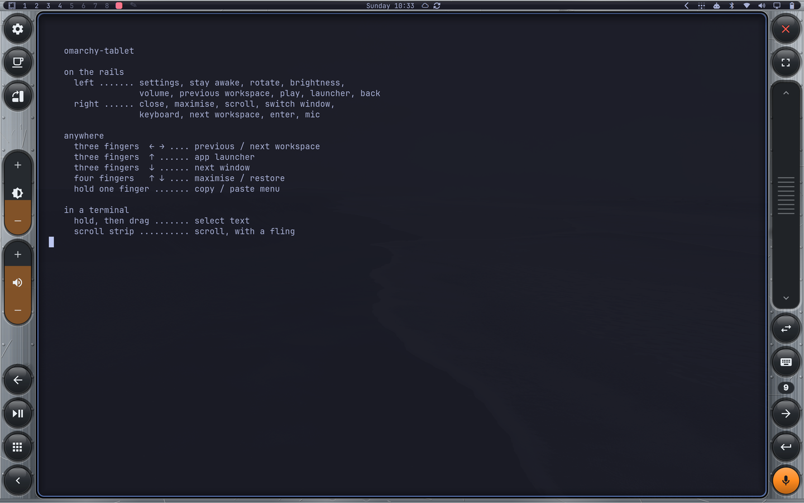
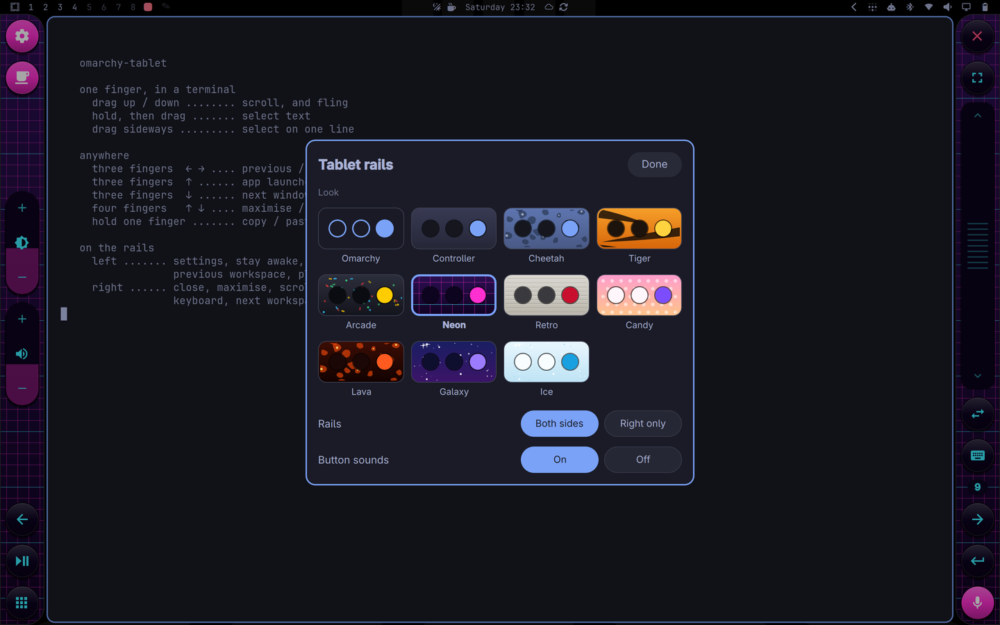
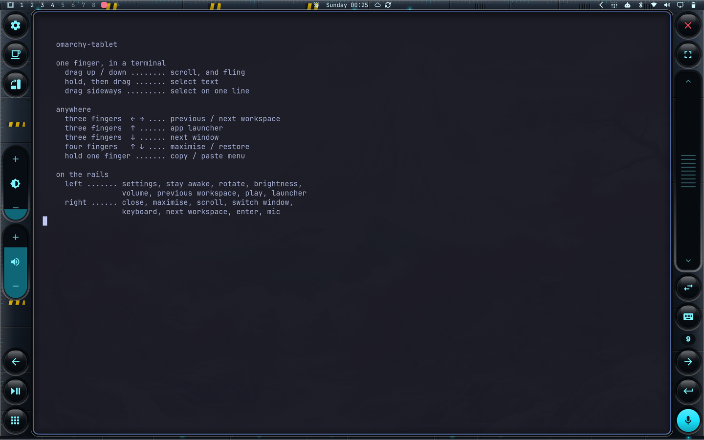
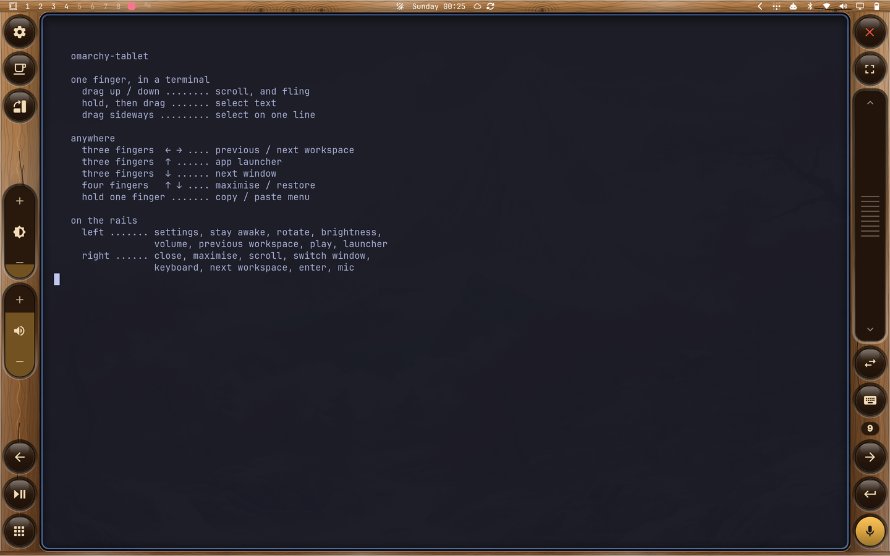
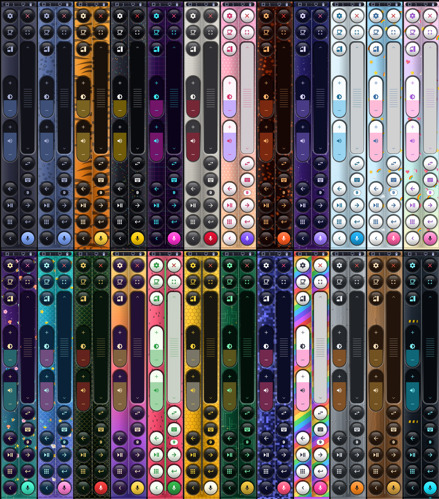
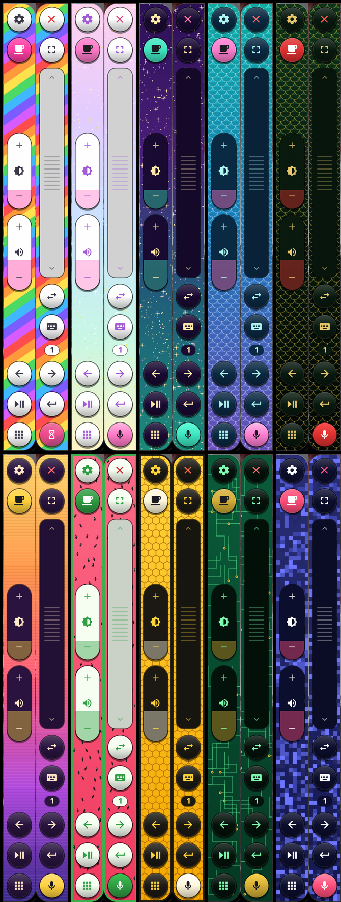
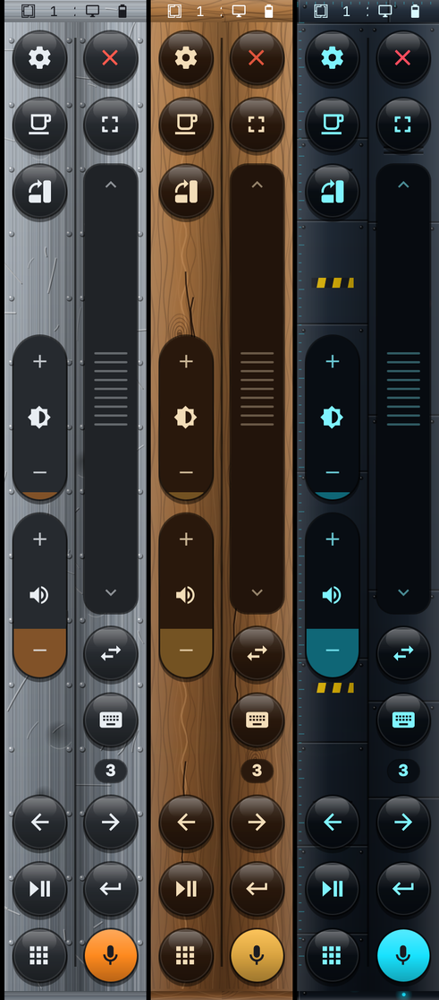

# omarchy-tablet

**Omarchy, on a tablet.**



Big tablets have never been good computers. The hardware has been ready for years: a 13-inch slate today has a screen as large as a laptop's and a processor that keeps up with one. What has never arrived is software that makes use of it. A phone interface stretched across thirteen inches wastes the screen. A desktop interface with the keyboard taken away is worse: there is no way to close a window, switch to another one, or type a password. So the big tablet ends up as the device you watch films on, next to the computer you actually work on.

[Omarchy](https://omarchy.org) showed what a laptop feels like when someone cares about every detail: simple, elegant, fast, and beautiful to look at. Nothing in the way, nothing you did not ask for, everything one keystroke from where you are. But all of it assumes a keyboard.

omarchy-tablet brings the same care to the tablet. Detach the keyboard and Omarchy stays Omarchy, the same windows, the same workspaces, the same theme, with everything the keyboard did now under your thumbs:

- **Two rails, one for each hand.** You hold a big tablet by its edges, so that is where the controls are, and the ones you use most sit lowest, where your thumbs already rest.
- **Gestures for getting around.** Three fingers to move between workspaces and windows, four to maximise.
- **A terminal you can use with a finger.** Drag to scroll, hold and drag to select. Tiling window managers live in the terminal; a tablet that cannot use one is not a computer.
- **A keyboard when you need one**, including on the lock screen, and a push-to-talk mic for when you would rather speak.
- **It looks like it belongs**, or like a game controller, if you would rather hold one of those.

No compositor plugin to rebuild on every update, and no new desktop to learn. It is a shell plugin, one small service that reads the touchscreen, and a few scripts.

| | |
|---|---|
|  |  |
| The default look follows your Omarchy theme. | The settings panel: looks, rotation, one rail or two, button sounds. |
|  |  |
| Spaceship: hull plates, warning stripes, status lights. | Wood: grain, knots and a split or two. |

## What you get

### The rails

A rail on each edge of the screen, shown while the machine is in tablet mode. Windows stop at them, so they never cover anything. A big tablet is held in both hands with a thumb on each edge, so the buttons are split by hand, and the most used sit lowest.

Every button's touch target is bigger than the button you see: it reaches out to the rail's edges and half-way to its neighbours, so there is no dead space between buttons, and a tap still counts if your thumb rolls off the button as it lifts.

**Right rail**, top to bottom:

| Button | Does |
|---|---|
| Close | Closes the focused window. Asks first: one tap arms it ("Close?"), a second tap within 3 s closes. |
| Maximise | Fills the screen with the focused window, or restores it. The bar and rails stay. |
| Scroll strip | Drag along it to scroll the focused window, like a mouse wheel: down moves further down the page. Let go while moving and it keeps going. |
| Switch | Focuses the next window on the workspace. If the current one fills the screen, the next takes its place. |
| Keyboard | Shows or hides the on-screen keyboard. |
| n › | The current workspace number, and next workspace. Hold the arrow to take the focused window along. |
| Enter | Sends Enter to the focused app. |
| Mic | Push-to-talk dictation, using Omarchy's default dictation backend (see [Dictation](#dictation)). |

**Left rail**, top to bottom:

| Button | Does |
|---|---|
| Settings | Opens the settings panel: look, screen rotation, one rail or two, button sounds. |
| Stay awake | While lit: no screensaver, no auto-lock, no screen-off. Same state as the bar's mug indicator. |
| Rotate | Tap to swap landscape and portrait; hold to turn the screen upside down. |
| Brightness | A rocker: plus at the top, minus at the bottom, hold to keep going. It fills from the bottom to show the current level. |
| Volume | The same rocker for volume; tap the speaker in the middle to mute. Uses Omarchy's own commands, so its on-screen display shows too. |
| ‹ | Previous workspace, level with "next" on the right rail, so each direction is under its own thumb. Hold to take the focused window along. |
| Play / pause | Hold for the next track. |
| Launcher | Opens the app menu. |

`tablet-mode rails right` puts everything except the media, volume and brightness controls on a single right-hand rail (hold Stay awake there for the settings panel); `tablet-mode rails both` brings the second one back. An upright screen always gets the single rail, along the bottom edge.

### Looks

  

By default the rails are drawn like every other Omarchy surface: your theme's colours, corner radius, border and gaps. Or pick a controller look, where the rails become a moulded shell flush with the screen edges, the buttons raised caps that sink when pressed, and the scroll strip a ridged thumb wheel:

| Look | |
|---|---|
| `theme` | Plain Omarchy (the default). |
| `controller` | A slate shell in your theme's colours. |
| `cheetah` | Your theme's accent colour, covered in cheetah spots. |
| `tiger` | Orange with black stripes. |
| `arcade` | Black with confetti and yellow buttons. |
| `neon` | Purple with a pink grid and cyan legends. |
| `retro` | Ridged grey plastic with red buttons. |
| `candy` | Pink polka dots, white caps. |
| `lava` | Black and red with glowing embers. |
| `galaxy` | Deep blue to violet, with stars. |
| `ice` | Pale blue and white. |
| `rainbow` | Sky blue, scattered with little rainbows, clouds and suns. |
| `unicorn` | A pastel wash with sparkles, covered in unicorns, hearts and stars. |
| `fairy` | Twilight purple into teal, with fairies, butterflies, mushrooms and fairy dust. |
| `mermaid` | Teal to violet scales, with mermaids, shells, fish and bubbles. |
| `dragon` | Dark green scales edged in gold, red buttons. |
| `sunset` | Yellow through pink to deep purple. |
| `watermelon` | Pink with seeds and a green rind. |
| `honeybee` | Honeycomb yellow with black caps. |
| `circuit` | A green circuit board with gold solder pads. |
| `pixel` | Blocky 8-bit blues. |
| `prism` | Diagonal rainbow stripes, white caps. |
| `metal` | Brushed steel with rivets down the edges, scratched and dented from use. |
| `wood` | Grain, knots and a split or two. Brass buttons. |
| `spaceship` | Hull plating: seams, bolts, vents, warning stripes and status lights. |

Choose one in the settings panel (the cog at the top of the left rail), or with `tablet-mode look <name>`.

**Made to look like a thing you are holding.** In a controller look the screen is set down into the frame: a lit lip where the frame ends, the dark wall of the recess, and the shadow the frame throws across the edge of the screen. Every button sits in a socket cut into the shell, with its legend engraved. The frame's outer edges are chamfered, light falls across it from above, and polished materials throw it back in broad bands.

**The bar joins in.** With a controller look on, Omarchy's top bar is drawn in the same shell, pattern and all, and meets the rails in rounded inside corners; a thin bezel in the same shell closes the frame along the bottom (it takes 8 px of height), so the screen sits inside one object. The bar's writing keeps your theme's colour and sits on a status glass, a dark window let into the shell, so it reads the same on a pale shell as on a dark one (and Omarchy's own panels, which share that colour, are left alone). With the plain look, with the keyboard attached, or with the bar somewhere other than the top, the bar is left exactly as your theme has it.

**Edges.** With a controller look, the side of each rail that faces the screen need not be straight: `tablet-mode edge lightning`, `wave`, `scallop`, `flame` or `saw` (or the Edge row in the settings panel) gives it that outline, and the recess, its lip and its shadow follow it. A shaped edge stands up to 15 px over the edge of your windows; it is only drawn there, and a touch on it still goes to the window underneath. `straight` is the default.

**Slide away.** `tablet-mode hide 30` (or "Slide away when idle" in the settings panel) slides the rails and the bottom bezel off their edges after that many seconds without a touch, and gives the windows the space; the next touch anywhere brings them back. Not while you are dictating or in the settings. `tablet-mode hide 0`, the default, keeps them in place.

**Button sounds.** `tablet-mode sounds on` (or the settings panel) plays a soft tap as a button goes down. Off by default. The mic never makes one: it would be the first thing your dictation hears.

### Gestures

| Gesture | Does |
|---|---|
| Three fingers left / right | Next / previous workspace |
| Three fingers up | App launcher |
| Three fingers down | Next window on this workspace |
| Four fingers up / down | Maximise / restore the focused window |
| Hold one finger still | Copy / Paste / Select all menu beside the finger (not in browsers, which have their own) |

### Terminals

Ghostty does little useful with a finger. With its scrollbar on, a touch drag scrolls one line per pixel; with it off, a drag does nothing; it never selects text by touch. So the installer turns the scrollbar off and the gesture daemon supplies both, as ordinary mouse input:

| Gesture over a terminal | Does |
|---|---|
| Drag up / down | Scrolls at about finger speed. Lift while moving and it flings; touch to stop. |
| Hold, then drag, then lift | Selects from where you held to where you lifted. The Copy / Paste menu appears beside it. |
| Drag that starts sideways | Selects, without the hold. |
| Two fingers up / down | Scrolls. |

The selection is highlighted when you lift, not while you drag. GTK gives a widget's click gesture to one input at a time, so the terminal ignores mouse input for as long as a finger rests on it; the drag is played to it once the finger is up.

Terminals recognised: Ghostty, foot, Alacritty, kitty, WezTerm (`TABLET_GESTURES_SCROLL_CLASSES` to change). The scrollbar setting and the measurements are Ghostty's; the others are untested.

### Rotation

The screen turns only when you say so. The Rotate button swaps landscape and portrait, and the settings panel has all three choices:

| | |
|---|---|
| Landscape | Stays in landscape. Two rails. |
| Portrait | Stays in portrait. The buttons become one bar along the bottom edge. |
| Auto-rotate | Follows the tablet as you turn it. Offered only where Linux can read the tablet's orientation sensor (`iio-sensor-proxy` installed and reporting an accelerometer); greyed out otherwise. |

`tablet-mode rotate landscape|portrait|auto|toggle|flip` does the same from a terminal. If portrait comes up the wrong way round for how you hold the tablet, put `270` in `~/.config/tablet-mode/portrait-turn` (the default is `90`).

### Also

- **On-screen keyboard** ([wvkbd](https://github.com/jjsullivan5196/wvkbd)) that appears over the lock screen when there is no keyboard to unlock with, and sits above Omarchy's panels, so typing a Wi-Fi password does not close the Wi-Fi panel.
- **Power button**: a tap locks, a hold opens the System menu (in tablet mode; with a keyboard attached it opens the menu as usual).
- **Screen timeout**: the display switches off after ten minutes without input. Omarchy's idle service locks but never blanks, which burns an OLED. Films and Stay awake are respected.

## Install

Needs Omarchy 4 (Hyprland with the Lua config, omarchy-shell) and a touchscreen.

```sh
git clone https://github.com/cryptob1/omarchy-tablet
cd omarchy-tablet
./install.sh
```

The installer installs `wvkbd` (AUR), `ydotool` and `jq` if they are missing (`--no-deps` to skip), copies the commands to `~/.local/bin`, enables the two shell plugins and the gesture service, adds one `require` line to `~/.config/hypr/hyprland.lua`, appends `scrollbar = never` to your Ghostty config, and restarts the shell. `ydotoold` must be running; the installer warns if it is not.

`./uninstall.sh` removes all of it again.

## Tablet mode

The rails show while the machine is in tablet mode. There is one switch:

```sh
tablet-mode set tablet     # show the rails
tablet-mode set laptop     # hide them
tablet-mode toggle
```

**Detachable keyboard.** List the keyboard's USB id (`lsusb`) and the mode follows it: tablet while it is off, laptop while it is on.

```sh
mkdir -p ~/.config/tablet-mode
echo "1234:abcd   # my keyboard dock" >> ~/.config/tablet-mode/keyboards
systemctl --user enable --now tablet-mode-watch.service
```

**Anything else** (a fold sensor, a hotkey): call `tablet-mode set …` yourself. Every executable in `~/.config/tablet-mode/hooks.d/` runs with the new mode as its argument.

## Dictation

The mic is a push-to-talk key: hold it and speak, let go and the text is typed into the app you were in. It uses Omarchy's own dictation, whichever backend Omarchy is set to use (`omarchy-dictation start` on press, `stop` on release), so there is nothing to configure. The installer shows the button when a dictation backend is installed; `tablet-mode dictation on|off` shows or hides it by hand.

To drive a different tool, give it two executables and it uses those instead:

```
~/.config/tablet-mode/mic-press      # run when the finger lands on the mic
~/.config/tablet-mode/mic-release    # run when it lifts
```

If the tool writes `recording` / `transcribing` / `idle` to `$XDG_RUNTIME_DIR/tablet-mode/mic-state`, the button turns red while it listens and pulses while it transcribes.

The button never takes keyboard focus, and focus is held on the window you were writing in until dictation finishes, so the text lands where you meant it.

`tablet-mode mic always` keeps a small floating mic, Enter and keyboard stack on screen with the keyboard attached too.

## How it works

- `shell/plugins/tablet.rail` — the rail, the floating stack and the long-press menu, as an omarchy-shell service plugin (Quickshell QML).
- `shell/plugins/tablet.screenoff` — the screen timeout.
- `bin/tablet-gestures` — a user service that reads the touchscreen's raw multitouch events and calls `hyprctl` / `ydotool`. Hyprland's own gestures are touchpad-only, and the usual answer (hyprgrass) is a compiled plugin that must be rebuilt for every Hyprland release.
- `bin/tablet-touch` — what the buttons and the menu do; the mic focus lock.
- `bin/tablet-osk`, `bin/tablet-mode`, `bin/tablet-power` — keyboard, mode switch, power button.
- `hypr/omarchy-tablet.lua` — layer rules (keyboard above the lock screen and panels) and the power-button bind.

The scripts' headers record what was tried and did not work, with the measurements. `tests/run.sh` runs the unit tests for the gesture logic.

## Status

Built and used on one machine: an ASUS ProArt PZ13 (Snapdragon, detachable keyboard) on Omarchy 4 with Hyprland 0.57 and Ghostty 1.4. Expect rough edges elsewhere, and please open an issue with what you find.

Known limits:

- A truly fullscreen window (a film) covers the rails. Leave fullscreen to get them back.
- After a fast fling a terminal can be left with a stray highlight; a tap clears it.
- The rail's bottom-edge layout for an upright screen has not been tried on a rotated screen.
- Multi-monitor: the rails are drawn on the first screen only.

## License

MIT
