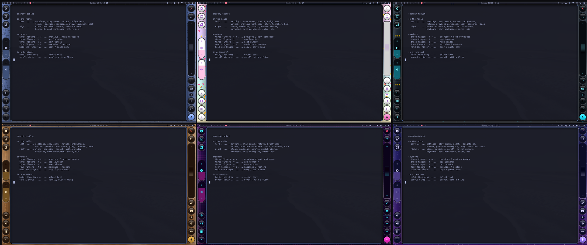

# omarchy-tablet

**Omarchy, on a tablet.** Detach the keyboard and Omarchy stays Omarchy: the same windows, workspaces and theme, with everything the keyboard did now under your thumbs.


```sh
git clone https://github.com/cryptob1/omarchy-tablet
cd omarchy-tablet && ./install.sh
tablet-mode set tablet
```

Needs [Omarchy](https://omarchy.org) 4 and a touchscreen. `./uninstall.sh` takes it all out again.

## What you get

- **Two rails, one for each hand.** You hold a big tablet by its edges, so that is where the controls are: close, maximise, switch window, back, apps, desktops, volume, brightness, paste, Enter.
- **A terminal you can use with a finger.** Tap clicks, a drag scrolls, hold a word to select it and drag to extend, as on a phone.
- **A keyboard for thumbs.** Split in two, one half against each rail, with digits and symbols between. It is also the keyboard on the lock screen.
- **A bottom band that knows what you are in.** Tab keys in a browser, Esc / Tab / arrows / Ctrl C in a terminal; desktops as numbered keys; Wi-Fi, Bluetooth, clock, and gauges for processor, memory, disk, battery and watts.
- **Gestures.** Three fingers to move between desktops and windows, four to maximise.
- **Voice.** A push-to-talk mic that types into the app you are in, using Omarchy's own dictation.
- **Portrait too.** Rotate, and the controls become a two-row bar along the bottom.
- **24 looks.** From plain Omarchy to a game controller, brushed metal or a ship's hull, each changing the frame, buttons and edges together.



No compositor plugin to rebuild on every update and no new desktop to learn: it is a shell plugin, one small service that reads the touchscreen, and a few scripts.

## Using it

The rails show while the machine is in tablet mode:

```sh
tablet-mode set tablet     # or: laptop, toggle
```

With a detachable keyboard the mode can follow it: list the keyboard's USB id in `~/.config/tablet-mode/keyboards` and enable `tablet-mode-watch.service`.

Everything else is in the settings panel (the cog at the top of the left rail): look, edge shape, button shape, rotation, keyboard, top bar, when the rails slide away, sounds.

**[The guide](docs/guide.md)** has every button, gesture and setting, how the pieces work, and how to plug in your own dictation or voice assistant.

## Status

Built and used on one machine: an ASUS ProArt PZ13 (Snapdragon, detachable keyboard) on Omarchy 4, Hyprland 0.57 and Ghostty 1.4. Expect rough edges elsewhere, and please open an issue with what you find.

Running Omarchy on a PZ13 yourself? [The PZ13 notes](docs/pz13/README.md) cover what the machine needed beyond a stock install: the disk prompt without a keyboard, sleep that stays asleep, the charge limit, and the speaker fault.

MIT licensed.
