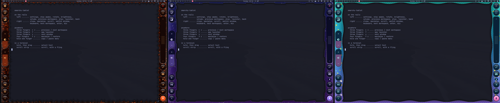
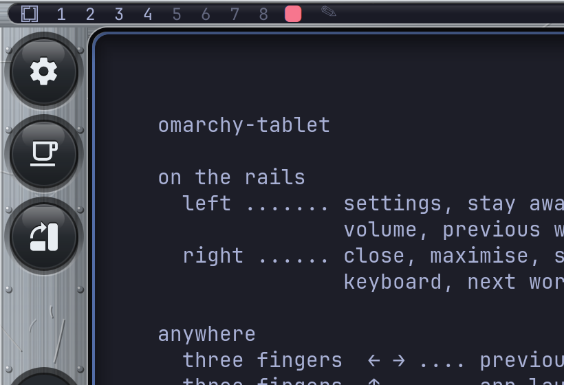
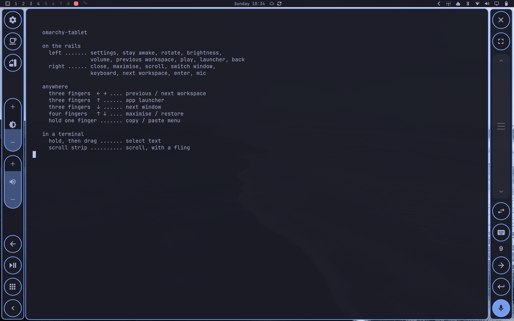

# omarchy-tablet

**Omarchy, on a tablet.** Two rails of touch controls, gestures, an on-screen keyboard and 24 looks, for [Omarchy](https://omarchy.org) with the keyboard off.


```sh
git clone https://github.com/cryptob1/omarchy-tablet
cd omarchy-tablet && ./install.sh
tablet-mode set tablet
```

Needs Omarchy 4 and a touchscreen. `./uninstall.sh` takes it all out again. [More on installing.](#install)

## Why

Big tablets have never been good computers. The hardware has been ready for years: a 13-inch slate today has a screen as large as a laptop's and a processor that keeps up with one. What has never arrived is software that makes use of it. A phone interface stretched across thirteen inches wastes the screen. A desktop interface with the keyboard taken away is worse: there is no way to close a window, switch to another one, or type a password. So the big tablet ends up as the device you watch films on, next to the computer you actually work on.

Omarchy showed what a laptop feels like when someone cares about every detail: simple, elegant, fast, and beautiful to look at. Nothing in the way, nothing you did not ask for, everything one keystroke from where you are. But all of it assumes a keyboard.

omarchy-tablet brings the same care to the tablet. Detach the keyboard and Omarchy stays Omarchy, the same windows, the same workspaces, the same theme, with everything the keyboard did now under your thumbs:

- **Two rails, one for each hand.** You hold a big tablet by its edges, so that is where the controls are, and the ones you use most sit lowest, where your thumbs already rest.
- **Gestures for getting around.** Three fingers to move between workspaces and windows, four to maximise.
- **A terminal you can use with a finger.** Hold and drag to select, a scroll wheel on the rail to scroll. Tiling window managers live in the terminal; a tablet that cannot use one is not a computer.
- **A keyboard when you need one**, including on the lock screen, and a push-to-talk mic for when you would rather speak.
- **It looks like it belongs**, or like something you are holding: a game controller, a slab of brushed metal, a spaceship.

No compositor plugin to rebuild on every update, and no new desktop to learn. It is a shell plugin, one small service that reads the touchscreen, and a few scripts.

## Make it yours

Twenty-four looks, from plain Omarchy to a ship's hull. Each one changes the shell, the buttons, their legends and the top bar together, and you switch between them from a settings panel on the rail.


The edge that faces the screen does not have to be straight. Lightning, wave, scallop, flame or saw, on any look:



| | |
|---|---|
|  |  |
| Made to look like a thing you are holding: buttons sit in sockets and sink when pressed, and the screen is set down into the frame. | The settings panel: look, edge shape, rotation, when the rails slide away, one rail or two, button sounds. |
|  | |
| Or leave it plain: the default look is your Omarchy theme, nothing more. | |

## What you get

### The rails

A rail on each edge of the screen, shown while the machine is in tablet mode. Windows stop at them, so they never cover anything. A big tablet is held in both hands with a thumb on each edge, so the buttons are split by hand, and the most used sit lowest.

Every button's touch target is bigger than the button you see: it reaches out to the rail's edges and half-way to its neighbours, so there is no dead space between buttons, and a tap still counts if your thumb rolls off the button as it lifts.

The order is set by how a tablet of this size is held. It has weight, so you grip it low on each side with your palms under the corners, and your thumbs rest about two thirds of the way down the screen. From there a thumb reaches up easily, down with a curl, and the top third not at all without letting go. So the things you use constantly are where the thumbs rest, the things you hold or drag are in easy reach, the corners get what you use least, and what you must not hit by accident is at the top. The lower rows of the two rails line up.

The left thumb moves you around (windows, back, apps, media); the right thumb puts things in (scroll, speak, Enter, paste, type). The numbered keys in the bottom band (see The pager) go straight to a desktop; the two arrows on the rails step to the next or the previous one.

**Right rail**, top to bottom:

| Button | Does |
|---|---|
| Close | Closes the focused window. Asks first: one tap arms it ("Close?"), a second tap within 3 s closes. At the top, out of the thumb's way. |
| Scroll strip | Drag along it to scroll the focused window, like a mouse wheel: down moves further down the page. Let go while moving and it keeps going. With an Omarchy picker open, it scrolls that instead. |
| › | Next desktop, level with "previous" on the left rail. Hold to take the focused window along. |
| Mic | Push-to-talk dictation, using Omarchy's default dictation backend (see [Dictation](#dictation)). Where the thumb rests, because you hold it while you speak. |
| Command | Hold and say what you want done: "open the browser", "next tab", "what's the battery at", "remind me to...". It is handed to the voice assistant as a command, never typed, and the answer is spoken. Shown when there is an assistant to take it: your own `~/.config/tablet-mode/command-press` and `command-release`, else Cortex (`cortex-ctl command-down` / `command-up`). |
| Enter | Sends Enter to the focused app: sends what you just said. |
| Paste | Pastes into the focused app; hold to copy instead. Uses the terminal's own shortcuts in a terminal. On the typing side, with the mic, Enter and the keyboard. |
| Keyboard | Shows or hides the on-screen keyboard. |

**Left rail**, top to bottom:

| Button | Does |
|---|---|
| Power | Opens a small sheet: Lock, Sleep, Restart, Shut down. Restart and Shut down ask for a second tap, and close your applications properly first. |
| Settings | Opens the settings panel: look, edge shape, screen rotation, when the rails slide away, one rail or two, button sounds. |
| Rotate | Tap to swap landscape and portrait; hold to turn the screen upside down. |
| Stay awake | While lit: no screensaver, no auto-lock, no screen-off. Same state as the bar's mug indicator. |
| Today | The time and date large enough to read at arm's length, the battery, and a month calendar. |
| Brightness | A rocker: plus at the top, minus at the bottom, hold to keep going. It fills from the bottom to show the current level. |
| Volume | The same rocker for volume; tap the speaker in the middle to mute. Uses Omarchy's own commands, so its on-screen display shows too. |
| ‹ | Previous desktop. Hold to take the focused window along. |
| Play / pause | Hold for the next track. |
| Maximise | Fills the screen with the focused window, or restores it. The rails stay. Next to Switch: the two window buttons are together. |
| Switch | Focuses the next window on the workspace. If the current one fills the screen, the next takes its place. |
| Back | Goes back in the focused app, as on a phone (it sends Alt+Left: back in browsers, file managers and most apps with a history); closes the app drawer or the settings panel if one is open. Hold for forward. Where the left thumb rests. |
| Apps | Opens the app drawer: every app, big, on nearly the whole screen. Drag or flick to scroll, tap to launch. Hold for Omarchy's own launcher (which has search, and wants a keyboard). Three fingers up opens the drawer too. |

`tablet-mode rails right` puts everything except the media, volume and brightness controls on a single right-hand rail (hold Stay awake there for the settings panel); `tablet-mode rails both` brings the second one back. An upright screen always gets the single rail, along the bottom edge.

### Looks

By default the rails are drawn like every other Omarchy surface: your theme's colours, corner radius, border and gaps. Or pick a controller look, where the rails become a moulded shell flush with the screen edges, the buttons raised caps that sink when pressed, and the scroll strip a ridged thumb wheel:

| Look | |
|---|---|
| `theme` | Plain Omarchy (the default). |
| `controller` | A slate shell in your theme's colours. |
| `cheetah` | Your theme's accent colour, covered in cheetah spots. |
| `tiger` | Orange with black stripes. |
| `arcade` | Black with confetti and yellow buttons. |
| `neon` | Purple with a pink grid and cyan legends. |
| `retro` | Ridged grey plastic with red buttons. |
| `candy` | Pink polka dots, white caps. |
| `lava` | Black and red with glowing embers. |
| `galaxy` | Deep blue to violet, with stars. |
| `ice` | Pale blue and white. |
| `rainbow` | Sky blue, scattered with little rainbows, clouds and suns. |
| `unicorn` | A pastel wash with sparkles, covered in unicorns, hearts and stars. |
| `fairy` | Twilight purple into teal, with fairies, butterflies, mushrooms and fairy dust. |
| `mermaid` | Teal to violet scales, with mermaids, shells, fish and bubbles. |
| `dragon` | Dark green scales edged in gold, red buttons. |
| `sunset` | Yellow through pink to deep purple. |
| `watermelon` | Pink with seeds and a green rind. |
| `honeybee` | Honeycomb yellow with black caps. |
| `circuit` | A green circuit board with gold solder pads. |
| `pixel` | Blocky 8-bit blues. |
| `prism` | Diagonal rainbow stripes, white caps. |
| `metal` | Brushed steel with rivets down the edges, scratched and dented from use. |
| `wood` | Grain, knots and a split or two. Brass buttons. |
| `spaceship` | Hull plating: seams, bolts, vents, warning stripes and status lights. |

Choose one in the settings panel (the cog at the top of the left rail), or with `tablet-mode look <name>`.

**Made to look like a thing you are holding.** In a controller look the screen is set down into the frame: a lit lip where the frame ends, the dark wall of the recess, and the shadow the frame throws across the edge of the screen. Every button sits in a socket cut into the shell, with its legend engraved, and sinks into it when pressed: the cap drops, its shadow closes up under it, and it comes back up as you let go. The frame's outer edges are chamfered, light falls across it from above, and polished materials throw it back in broad bands.

**The bar joins in.** With a controller look on, Omarchy's top bar is drawn in the same shell, pattern and all, and meets the rails in rounded inside corners; a thin bezel in the same shell closes the frame along the bottom (it takes 12 px of height), so the screen sits inside one object. The bar's writing keeps your theme's colour and sits on a status glass, a dark window let into the shell in the look's own dark colour (the buttons' brown on Wood, deep purple on Unicorn), so it reads the same on a pale shell as on a dark one (and Omarchy's own panels, which share that colour, are left alone). With the plain look, with the keyboard attached, or with the bar somewhere other than the top, the bar is left exactly as your theme has it.

**Button shape.** Buttons do not have to be round. `tablet-mode buttons round`, `rounded` or `square` (or the Buttons row in the settings panel) sets the shape for every look; `auto`, the default, lets each look choose: round on most, rounded squares on Metal, Spaceship, Neon, Retro and Circuit, square on Pixel. The rockers, the scroll wheel and their sockets follow.

**Edges.** With a controller look, the side of each rail that faces the screen need not be straight: `tablet-mode edge lightning`, `wave`, `scallop`, `flame` or `saw` (or the Edge row in the settings panel) gives it that outline, the bar and the bottom bezel take it too, so it runs all the way round the screen, and the recess, its lip and its shadow follow it. A shaped edge stands up to 15 px over the edge of your windows; it is only drawn there, and a touch on it still goes to the window underneath. `auto`, the default, is each look's own edge (flames on Lava, lightning on Galaxy and Neon, waves on Mermaid and Fairy, scallops on Unicorn and Candy, a saw on Tiger and Dragon, straight on the plainer ones); any other choice overrides it for every look.

**Slide away.** `tablet-mode hide 30` (or "Slide away when idle" in the settings panel) slides the rails and the bottom bezel off their edges after that many seconds without a touch, and gives the windows the space; the next touch anywhere brings them back. Not while you are dictating or in the settings. `tablet-mode hide 0`, the default, keeps them in place.

**The key strip.** Without a keyboard, the keys an app wants all the time are a whole on-screen keyboard away. So the bottom bezel grows a row of them, chosen by what has focus:

| Focused | Keys |
|---|---|
| A terminal | Esc, Tab, Shift+Tab, Ctrl+C, the four arrows, 1 2 3, /, Backspace, and **sudo**, which opens a small floating terminal running `sudo -v` and brings up the keyboard for the password (useful where sudo's password timer is shared by all terminals, `timestamp_type=global`) |
| A browser | Forward, reload, previous tab, next tab, new tab, close tab, reopen closed tab, address bar, find |

It appears with those apps and goes away with others (`tablet-mode keys auto`, the default); `always` keeps it up everywhere, `off` never shows it. It takes 36 px of height while it is up.

**The pager.** The desktops are numbered keys at the left end of the bottom band: tap one to go there, hold one to take the focused window there. The one you are on is lit and empty ones are faint. The rails keep a previous and a next arrow as well, for stepping without looking.

**The top bar, tucked away.** With the desktops, the battery and the time in the bottom band, Omarchy's bar has little left to say on a tablet, so while the band is up it is hidden and its height goes back to the windows. The clock key in the band brings it back for half a minute (or until you tap the clock again) for Wi-Fi, Bluetooth, sound and the tray. `tablet-mode topbar show` keeps it there always; it returns by itself when a keyboard is attached.

Next to the clock are a Wi-Fi key and a Bluetooth key, which open Omarchy's own panels without the bar. The meters take a tap too: the battery opens the power panel (power saver, balanced, performance), processor and memory the monitor panel.

**The thumb keyboard.** An ordinary on-screen keyboard runs the width of the screen, and held by its sides a 13-inch tablet lets your thumbs reach about a third of it. This one is split: the letters sit in two blocks, one against each rail, under your thumbs. Digits and symbols are all in the middle at once, so there are no layers to switch. Shift is one-shot (tap twice for caps lock), Ctrl is one-shot, and backspace and the arrows repeat while held. The windows make room, so what you are typing into stays in view. Upright, the digits and symbols move above the letters.

It is also the keyboard on the lock screen: touch a locked tablet and it comes up (the full-width one does instead if you chose that, or if this one fails to appear). The rail's keyboard button opens it. `tablet-mode keyboard full` switches to the full-width keyboard (wvkbd), `split` goes back. It is also in the settings panel.

**A PIN for the lock screen.** A password is a lot to type on glass many times a day. `tablet-pin` lets Omarchy's lock screen also take a PIN, hedged as a phone hedges it: six digits or more; five wrong PINs and it is off until the password is used; it works only if the full password has unlocked the screen since the last restart and within the last 24 hours. The full password always works, and nothing else ever sees the PIN: not sudo, not login, not ssh, not the disk's passphrase. While the PIN is usable the lock screen's keyboard is a number pad (its "abc" key brings the letters back).

It is off until you turn it on, because it changes how the machine is unlocked:

```
tablet-pin set               # choose the PIN
sudo tablet-pin install      # add it to the lock screen's sign-in (two lines in /etc/pam.d/omarchy-lock-password)
                             # ...lock, unlock with the password, lock, unlock with the PIN...
sudo tablet-pin confirm      # keep it; without this, install undoes itself after ten minutes
```

`sudo tablet-pin uninstall` takes it out; `tablet-pin clear` forgets the PIN. What it is and is not worth is written at the top of `bin/tablet-pin`: it defends against a person holding the tablet, not against a program already running as you.

**Load.** Five small gauges at the right end of the bottom band, each with its figure and a lit bar: processor, memory, disk (how full the root filesystem is), battery, and the watts going out of (or into) the battery. Processor and memory turn the look's warning colour above 85%, the disk above 90%, the battery below 15%.

**Button sounds.** `tablet-mode sounds on` (or the settings panel) plays a soft tap as a button goes down. Off by default. The mic never makes one: it would be the first thing your dictation hears.

### Gestures

| Gesture | Does |
|---|---|
| Three fingers left / right | Next / previous workspace |
| Three fingers up | The app drawer |
| Three fingers down | Next window on this workspace |
| Four fingers up / down | Maximise / restore the focused window |
| Hold one finger still | Copy / Paste / Select all menu beside the finger (not in browsers, which have their own) |

### Terminals

A terminal is a mouse program. Given a finger, Ghostty treats it as a mouse button going down wherever the pointer last was: a tap lands in the wrong place, and a scroll drags a selection behind it. A program that reads the mouse itself (herdr, tmux, anything with tabs to tap) makes both worse.

So terminals never get the finger. The shell plugin keeps a see-through surface over every terminal window, which takes each touch; the gesture service, which reads the panel directly, works out what the touch meant and sends that as clean pointer events, lifting the surface aside for the moment it takes.

| Gesture over a terminal | Does |
|---|---|
| Tap | A click exactly there: tabs, panes and buttons in a terminal program work. |
| Drag up / down, one finger or two | Scrolls, with a fling. Nothing is selected. |
| Hold on a word | Selects that word, as on a phone, and shows Copy / Paste / Select all. |
| Hold, then drag | Selects from where you held to where the finger is, following it. Lift, and the menu is there to copy it. |
| Drag that starts sideways | Selects letter by letter under the finger, without the hold. |
| The rail's scroll strip | Scrolls the focused terminal without touching it. |

A terminal with another window floating over it, or a fullscreen one, is left uncovered and behaves as Ghostty does by itself. Selections are made with Shift held, which is how a terminal is told to select for itself inside a program that reads the mouse (herdr, tmux, vim): it works the same there as at a shell prompt. `TABLET_GESTURES_COVER=0` in the gesture service's environment turns the cover off.

### Rotation

The screen turns only when you say so. The Rotate button swaps landscape and portrait, and the settings panel has all three choices:

| | |
|---|---|
| Landscape | Stays in landscape. Two rails. |
| Portrait | Stays in portrait. The buttons become one bar along the bottom edge. |
| Auto-rotate | Follows the tablet as you turn it. Offered only where Linux can read the tablet's orientation sensor (`iio-sensor-proxy` installed and reporting an accelerometer); greyed out otherwise. |

`tablet-mode rotate landscape|portrait|auto|toggle|flip` does the same from a terminal. If portrait comes up the wrong way round for how you hold the tablet, put `270` in `~/.config/tablet-mode/portrait-turn` (the default is `90`).

### Also

- **On-screen keyboard** ([wvkbd](https://github.com/jjsullivan5196/wvkbd)) that appears over the lock screen when there is no keyboard to unlock with, and sits above Omarchy's panels, so typing a Wi-Fi password does not close the Wi-Fi panel.
- **Power button**: a tap opens the power sheet (Lock, Sleep, Restart, Shut down; tap again to dismiss), a hold locks at once (in tablet mode; with a keyboard attached it opens Omarchy's System menu as usual).
- **Screen timeout**: the display switches off after ten minutes without input. Omarchy's idle service locks but never blanks, which burns an OLED. Films and Stay awake are respected.

## Install

Needs Omarchy 4 (Hyprland with the Lua config, omarchy-shell) and a touchscreen.

```sh
git clone https://github.com/cryptob1/omarchy-tablet
cd omarchy-tablet
./install.sh
```

The installer installs `wvkbd` (AUR), `ydotool` and `jq` if they are missing (`--no-deps` to skip), copies the commands to `~/.local/bin`, enables the two shell plugins and the gesture service, adds one `require` line to `~/.config/hypr/hyprland.lua`, appends `scrollbar = never` to your Ghostty config, and restarts the shell. `ydotoold` must be running; the installer warns if it is not.

`./uninstall.sh` removes all of it again.

## Tablet mode

The rails show while the machine is in tablet mode. There is one switch:

```sh
tablet-mode set tablet     # show the rails
tablet-mode set laptop     # hide them
tablet-mode toggle
```

**Detachable keyboard.** List the keyboard's USB id (`lsusb`) and the mode follows it: tablet while it is off, laptop while it is on.

```sh
mkdir -p ~/.config/tablet-mode
echo "1234:abcd   # my keyboard dock" >> ~/.config/tablet-mode/keyboards
systemctl --user enable --now tablet-mode-watch.service
```

**Anything else** (a fold sensor, a hotkey): call `tablet-mode set …` yourself. Every executable in `~/.config/tablet-mode/hooks.d/` runs with the new mode as its argument.

## Dictation

The mic is a push-to-talk key: hold it and speak, let go and the text is typed into the app you were in. It uses Omarchy's own dictation, whichever backend Omarchy is set to use (`omarchy-dictation start` on press, `stop` on release), so there is nothing to configure. The installer shows the button when a dictation backend is installed; `tablet-mode dictation on|off` shows or hides it by hand.

To drive a different tool, give it two executables and it uses those instead:

```
~/.config/tablet-mode/mic-press      # run when the finger lands on the mic
~/.config/tablet-mode/mic-release    # run when it lifts
```

If the tool writes `recording` / `transcribing` / `idle` to `$XDG_RUNTIME_DIR/tablet-mode/mic-state`, the button turns red while it listens and pulses while it transcribes.

The button never takes keyboard focus, and focus is held on the window you were writing in until dictation finishes, so the text lands where you meant it.

`tablet-mode mic always` keeps a small floating mic, Enter and keyboard stack on screen with the keyboard attached too.

## How it works

- `shell/plugins/tablet.rail` — the rail, the floating stack and the long-press menu, as an omarchy-shell service plugin (Quickshell QML).
- `shell/plugins/tablet.screenoff` — the screen timeout.
- `bin/tablet-gestures` — a user service that reads the touchscreen's raw multitouch events and calls `hyprctl` / `ydotool`. Hyprland's own gestures are touchpad-only, and the usual answer (hyprgrass) is a compiled plugin that must be rebuilt for every Hyprland release.
- `bin/tablet-touch` — what the buttons and the menu do; the mic focus lock.
- `bin/tablet-osk`, `bin/tablet-mode`, `bin/tablet-power` — keyboard, mode switch, power button.
- `hypr/omarchy-tablet.lua` — layer rules (keyboard above the lock screen and panels) and the power-button bind.

The scripts' headers record what was tried and did not work, with the measurements. `tests/run.sh` runs the unit tests for the gesture logic.

## Status

Built and used on one machine: an ASUS ProArt PZ13 (Snapdragon, detachable keyboard) on Omarchy 4 with Hyprland 0.57 and Ghostty 1.4. Expect rough edges elsewhere, and please open an issue with what you find.

Known limits:

- A truly fullscreen window (a film) covers the rails. Leave fullscreen to get them back.
- After a fast fling a terminal can be left with a stray highlight; a tap clears it.
- The rail's bottom-edge layout for an upright screen has not been tried on a rotated screen.
- Multi-monitor: the rails are drawn on the first screen only.

## License

MIT
